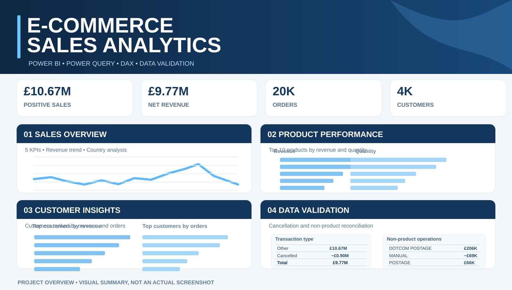

# E-Commerce Sales Analytics | Power BI

> **Visual project summary:** This illustration presents the four report sections. Original Power BI screenshots and the editable report file will be uploaded separately.

An interactive **Business Intelligence portfolio project** exploring online retail sales, product performance, customer behavior, and revenue reconciliation.

**Tools:** Power BI Desktop · Power Query · DAX · Data Cleaning · Data Visualization  
**Data source:** [UCI Online Retail](https://archive.ics.uci.edu/dataset/352/online+retail)  
**Analysis period:** 1 December 2010 – 9 December 2011

## Project objectives

- Monitor sales, order volume, average order value, and customer activity.
- Compare **positive-line revenue** against revenue after cancellation-type transactions.
- Identify top-selling products, key customers, and major sales markets.
- Build a transparent reconciliation of **net revenue** and selected **non-product** transactions.

## Dashboard pages

| Page | Contents |
| --- | --- |
| **Sales Overview** | Five KPI cards, monthly revenue trend, revenue by country, country and date slicers |
| **Product Performance** | Top 10 products by positive-line revenue and gross quantity |
| **Customer Insights** | Distinct identified customers and top 10 customers by revenue and order count |
| **Data Validation** | Revenue reconciliation by transaction type and a breakdown of identified non-product descriptions |

## Key performance indicators

*Values below cover the full reporting period, with country set to All. Card figures marked “≈” are rounded in Power BI.*

| KPI | Value |
| --- | ---: |
| **Total Revenue** (positive-line revenue, before cancellations) | **£10.67M** |
| **Total Orders** | **≈20K** |
| **Average Order Value** | **£534.40** |
| **Total Customers** (nonblank customer IDs) | **≈4K** |
| **Net Revenue** | **£9.77M** |
| **Net Product Revenue** (current ProductType rule) | **£9.57M** |

### Revenue reconciliation (unrounded)

| Component | Amount |
| --- | ---: |
| Positive-line revenue | £10,666,684.54 |
| Cancellation-type lines | −£896,812.49 |
| **Net Revenue** | **£9,769,872.05** |
| Identified non-product net amount | −£203,804.48 |
| **Net Product Revenue** | **£9,566,067.57** |

The net-product figure excludes transactions classified as non-product by the project’s **limited, explicit classification rules**. It should not be treated as a fully audited merchandise-revenue figure.

## Approach

1. **Import and preparation:** load Online Retail data in Power Query and inspect quantities, prices, invoices, dates, and customer IDs.
2. **Gross/positive-line sales table:** create `Sales_Analysis` for non-cancelled transactions with `Quantity > 0` and `UnitPrice > 0`. Compute `LineRevenue = Quantity × UnitPrice`.
3. **Net sales table:** create `Sales_Net_Analysis` including negative quantities at `UnitPrice > 0`; compute `NetLineRevenue = Quantity × UnitPrice`.
4. **DAX reporting:** define total revenue, net revenue, orders, average order value, and customer measures. Use country and date filters consistently across the separate analysis tables.
5. **Validation and visualization:** reconcile positive and cancellation amounts, identify selected non-product entries, and create the four report pages.

See [Data Methodology](docs/Data_Methodology.md) for detailed definitions and caveats.

## Key findings

- **United Kingdom** is the leading market by revenue in the report’s country ranking.
- Monthly revenue is highest around **November 2011**; **December 2011 is a partial month** in the source dataset.
- Top products by gross quantity include unusually large transactions that also appear in cancellation records. Gross quantity should **not** be interpreted as net customer demand.
- High-value customers and frequent-order customers form different rankings.
- The current non-product classification identifies a **£203,804.48** net contribution from `DOTCOM POSTAGE`, `POSTAGE`, and `MANUAL`.

Read the [Business Insights](docs/Business_Insights.md) for interpretation and next analytical steps.

## Screenshots and Power BI file

The four dashboard screenshots have been prepared and can be added to a `screenshots/` directory:

1. `01_sales_overview.png`
2. `02_product_performance.png`
3. `03_customer_insights.png`
4. `04_data_validation.png`

**Pending upload:** The original PNG screenshots and the editable `Ecommerce_Sales_Analytics_Final.pbix` are prepared but have not been uploaded to this repository yet. The existing overview illustration is not a Power BI screenshot.

## Data source and scope

**UCI Machine Learning Repository — Online Retail:** https://archive.ics.uci.edu/dataset/352/online+retail

The raw dataset is not redistributed in this repository. Download it from the original provider, subject to its published terms.

### Important limitations

- Positive-line revenue is **gross of cancellation transactions** and may include non-product descriptions.
- Negative and zero unit-price lines are not included in the current net analysis.
- Invoice numbers starting with `C` identify cancellation-type lines in this model.
- The `ProductType` classification is **not exhaustive**: other fees, adjustments, or non-merchandise labels may remain classified as products.
- Some customers have missing IDs; the customer KPI excludes blanks.
- Certain KPI cards display rounded counts; the reconciliation table retains two decimals.
- This is a **portfolio demonstration**, not an audited finance report.
